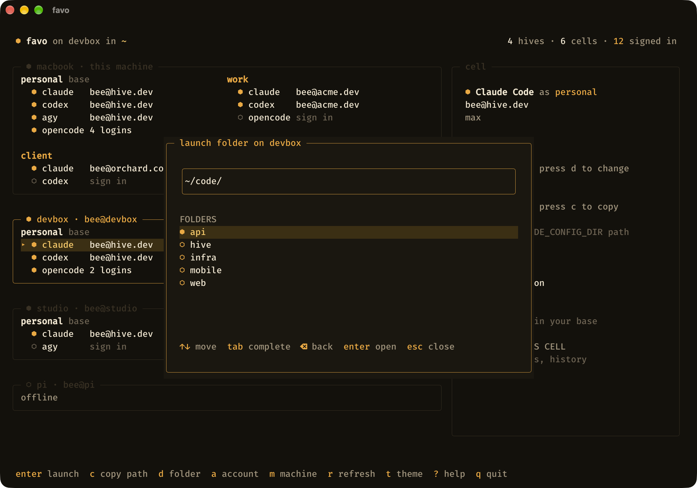
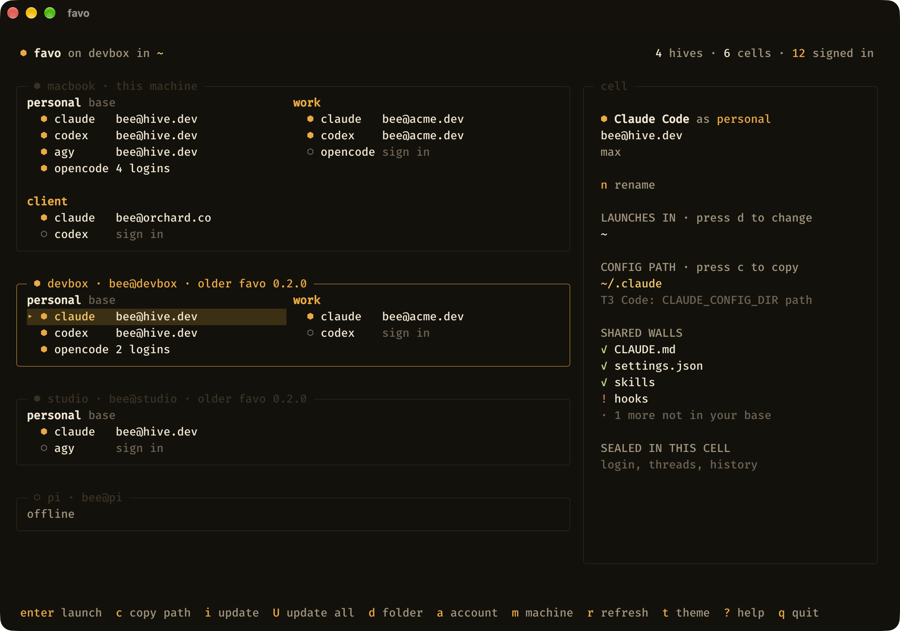
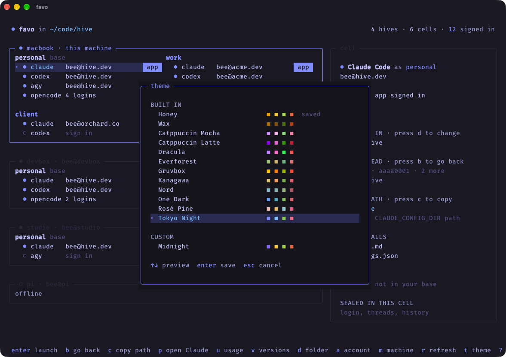
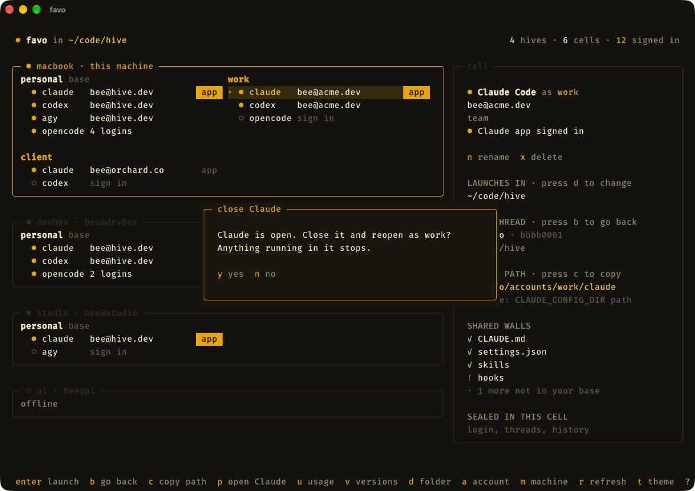

<p align="center">
  
  
</p>

<h3 align="center">Every AI subscription you have, on every computer you own.<br>No more logging in and out.</h3>

<p align="center">
  <a href="https://www.npmjs.com/package/favo-cli"></a>
  <a href="https://github.com/irwinarruda/favo-cli/actions/workflows/ci.yml"></a>
  <a href="LICENSE"></a>
  
</p>

<p align="center">
  <a href="#install">Install</a> ·
  <a href="#what-you-get">What you get</a> ·
  <a href="#supported-providers">Providers</a> ·
  <a href="#how-it-works">How it works</a> ·
  <a href="#faq">FAQ</a>
</p>

<p align="center">
  
  
</p>

favo runs Claude Code, Codex, Antigravity CLI and OpenCode under as many accounts as you have, at the same time, on all your machines. Each account keeps its own login and threads. Your `CLAUDE.md`, skills and settings follow you into all of them.

**Before**

```sh
claude auth logout
claude auth login      # the browser again, the other account, and your place is gone
```

**With favo**

```sh
favo claude work       # Claude Code as work
favo claude personal   # and as personal, in the next tab
favo codex client      # Codex as a client's account
```

## Install

```sh
npm install --global favo-cli           # macOS, Linux and Windows
brew install irwinarruda/tap/favo-cli   # or Homebrew, on macOS and Linux
```

Everywhere you install it, the name is `favo-cli`. The command you run is `favo`. The npm install needs Node 20.11 or newer, and Homebrew needs nothing else ([details](#install-details)). To try it without installing, use `npx favo-cli`; plain `npx favo` runs an unrelated package.

Your first account is already there: `personal` is the setup you have today. To add another:

```sh
favo add work            # a new cell
favo login work claude   # sign in, with Claude's own login
favo claude work         # go
```

## What you get

### Every account, signed in, at once

There is nothing to switch. Each account lives in its own cell, so a work session and a personal session can run side by side, and neither signs the other out.

### Your setup, written once

Skills, `CLAUDE.md`, `AGENTS.md`, hooks and settings are linked into every account from your normal config folders. Edit a skill once and every account sees it. Logins and threads stay private to their cell.

### Your other computers, in the same view

Add a machine once. favo installs itself there, and from then on that machine sits in the same view, and every action works on it: launch, sign in, add an account. It works over ssh or Tailscale, with no ports, tunnels or daemons.

```sh
favo machine discover         # what is on ssh and Tailscale
favo machine add bee@devbox   # connect, and install favo there
favo claude work --machine devbox
```

Choosing where a provider starts works remotely too. Here the Mac is browsing the real folders on a Linux box:

<p align="center">
  
</p>

When a machine falls behind, favo says so and keeps it working. Press `U` to update them all:

<p align="center">
  
</p>

### A TUI you will want to leave open

See every machine, account and login, spot what needs signing in, and press `enter` to launch. Prefer scripts? Everything is a command too, and `favo list --json` gives you the same view as data.

Twelve themes come built in, with a live preview, and your own is a small JSON file away:

<p align="center">
  
</p>

### Works with what you already use

Your `~/.claude`, `~/.codex` and the rest stay where they are, and an old config folder can move in with `favo adopt work claude ~/.claude-work`. Using [T3 Code](#use-it-with-t3-code)? Press `c` on any seat to copy the path it needs.

## Desktop apps

favo can also open the **Claude** and **ChatGPT** desktop apps as any account. Press `p` on a seat, or run:

```sh
favo app work claude         # Claude, as work
favo app work codex          # ChatGPT, as work
favo app personal claude     # back to the app you always had
favo app work claude --close # close it first if it is open
```

The first time, sign in inside the app. It remembers each account after that, and the Claude Code or Codex inside it uses the same seat as the CLI. `p` only appears when the app is installed on the computer you are at. If the app is already open, favo asks first:

<p align="center">
  
</p>

> [!WARNING]
> **This is unofficial.** Neither app documents running several accounts, so an update could break it. Your apps themselves stay as they were, and `personal` always opens the default one.

- One account at a time, per app. favo closes the app to switch, and anything running in it stops.
- Opening the app from the Dock or Start menu uses your default account, not the last one favo opened.
- A login stays on the computer where you signed in. It does not travel to your other machines.
- On Windows, Cowork may not work outside your default account, and a sign-in that bounces to your browser can get lost. Use the emailed code if it does.
- macOS, Windows, and the official Linux packages for Ubuntu and Debian. In WSL, run favo on Windows instead.

## Supported providers

| Provider        | Private to each account | Shared across accounts                                                     |
| --------------- | ----------------------- | -------------------------------------------------------------------------- |
| Claude Code     | login, threads, history | CLAUDE.md, settings, skills, agents, commands, hooks, plugins, keybindings |
| Codex           | login, threads, history | AGENTS.md, config.toml, hooks.json, skills, agents, rules, prompts         |
| OpenCode        | logins, threads         | all of its config                                                          |
| Antigravity CLI | conversations           | GEMINI.md, settings, skills, plugins                                       |

> [!WARNING]
> **Antigravity is the exception.** Conversations are separate per account, but favo could not verify that its login is, and the TUI says so on that seat. It also runs in a private home folder that mirrors yours, so it can see your other files there, not only the shared list above.

## How it works

_favo_ means honeycomb in Portuguese and Italian. Each account is a sealed cell, and the walls between cells are shared.

Your `personal` account is the labs' own folders, untouched. Every other account gets its own folder, and favo starts the official CLI pointed at it:

```text
~/.favo/accounts/
  work/
    claude/    CLAUDE_CONFIG_DIR points here
    codex/     CODEX_HOME points here
  side/
    claude/
```

Inside a cell, an item is either shared or private. Shared items are a named list per provider, linked back to your own config. Everything else stays private to the cell, including anything a provider adds next year. Links are checked at launch and with `favo sync`, and a real file where a link belongs is reported and left alone.

## FAQ

**Is favo a proxy? Does it pool or rotate accounts?**
No. favo starts the official CLI with the right folder set, then gets out of the way. Your requests go straight from that CLI to its provider, and you always choose which account runs.

**Can favo see my tokens?**
favo never reads them. Logins run each provider's own command, and credentials stay wherever that provider keeps them. One thing to watch: settings are shared, so an API key you put in `settings.json` or `config.toml` is visible to every account.

**What happens to my existing config?**
It stays where it is and becomes your `personal` account. Shared items in other accounts are links to it, so editing one edits your original.

**Does favo phone home?**
There is no telemetry. favo's own network use is downloading its release from GitHub: on the npm package's first run, and when it installs itself on another machine. Reaching your machines goes over your own ssh.

**Why not a shell alias with `CLAUDE_CONFIG_DIR`?**
That gives you a second login, and it's how many of us started. The new folder starts empty, though, so you maintain your setup twice, and it stops at one machine and one provider. favo keeps the setup shared and does the same for all four providers, across your computers.

**How do I uninstall it?**
Run `npm uninstall --global favo-cli` or `brew uninstall favo-cli`, then delete `~/.favo`. That removes every account except `personal`, along with their logins and threads, and leaves your normal config folders alone.

## Reference

### Install details

| System  | Supported                                 |
| ------- | ----------------------------------------- |
| macOS   | Apple Silicon and Intel                   |
| Linux   | x64 and arm64, glibc (not Alpine or musl) |
| Windows | x64                                       |

The npm package is a small launcher with no dependencies and no install scripts. The first run downloads the right binary, about 40 MB, from [GitHub Releases](https://github.com/irwinarruda/favo-cli/releases) and checks it against the hashes published in the npm package. After that, favo starts with no network. Homebrew installs the same binary directly, with no launcher and no Node.

To update, run `npm install --global favo-cli@latest` or `brew upgrade favo-cli`, then `favo machine update` to bring every other machine along. favo marks a machine on an older version as `older favo` and keeps it working until you do.

### Use it with T3 Code

T3 Code starts providers itself, so it only needs the folder. Select a seat, press `c`, and paste into a Claude provider's **CLAUDE_CONFIG_DIR path** or a Codex provider's **CODEX_HOME path**.

### Commands

```sh
favo                         # open the comb
favo add work                # a new cell
favo login work claude       # sign in, with the official command
favo logout work claude      # sign out
favo claude work             # run Claude Code as work
favo claude work -- --resume # everything after -- goes to the provider
favo claude work --dir ~/app # start it in that folder
favo list                    # every machine, account and login
favo usage                   # what every seat has left, and when it comes back
favo rename work client      # a new name, on this machine
favo rm work                 # move a cell to the trash
favo sync                    # repair shared links
favo inspect work claude     # what is shared and what is private
favo path work claude        # print the config path
favo app work claude         # open the Claude app as work
favo theme tokyo-night       # pick a theme
```

Providers are `claude`, `codex`, `agy` and `opencode`. Most commands take `--machine <machine>` to run on another computer. `favo --help` lists the rest.

`favo usage` and the `u` screen ask Claude Code and Codex through their own commands, so no token is read and no thread starts. OpenCode and Antigravity show no limits for now, because neither has a source that works without a token. The bars show what is left: `╱` is what the next reset gives back, and `│` is how much of the window is left, so a bar that stops short of it is spending too fast.

`favo rm` keeps the cell in `~/.favo/trash`, login included, until you delete that folder yourself. `favo adopt` refuses a folder inside `~/.favo` or a provider's base folder.

<details>
<summary><strong>Keys in the TUI</strong></summary>

| Key                 | Does                                |
| ------------------- | ----------------------------------- |
| arrows or `h j k l` | move around                         |
| `enter`             | launch the selected seat            |
| `s` / `o`           | sign in / sign out                  |
| `c`                 | copy its config path                |
| `u`                 | see what every seat has left        |
| `d`                 | choose the folder it launches in    |
| `a`                 | add an account                      |
| `n`                 | rename the selected cell            |
| `x`                 | delete the selected cell            |
| `m`                 | add a machine                       |
| `i`                 | install or update favo on a machine |
| `U`                 | update favo on every machine        |
| `X`                 | forget a machine                    |
| `r` / `R`           | refresh / repair shared links       |
| `t`                 | pick a theme                        |
| `?`                 | help                                |
| `q`                 | quit                                |

The base cell can be renamed but never deleted. A rename only changes the name you see, so logins, threads and paths keep working.

</details>

<details>
<summary><strong>Themes and custom themes</strong></summary>

Press `t` to pick a theme with a live preview, or use `favo theme <name>`.

Built in: `honey`, `wax` (light), `catppuccin`, `catppuccin-latte` (light), `dracula`, `everforest`, `gruvbox`, `kanagawa`, `nord`, `one-dark`, `rose-pine`, `tokyo-night`.

A custom theme is a JSON file in `~/.favo/themes`, and its file name is its id. Leave out any color and it comes from the theme it extends, `honey` by default:

```json
{
  "name": "Midnight Hive",
  "extends": "tokyo-night",
  "colors": { "accent": "#7788FF", "background": "#0D0E14" }
}
```

Colors are `background`, `panel`, `selection`, `border`, `accent`, `accentBright`, `text`, `muted`, `faint`, `success` and `danger`.

</details>

<details>
<summary><strong>Always pass arguments to a provider</strong></summary>

Add `launchArgs` to `~/.favo/config.json`:

```json
{ "providers": { "claude": { "launchArgs": ["--dangerously-skip-permissions"] } } }
```

</details>

<details>
<summary><strong>Other machines</strong></summary>

To install itself, favo downloads the binary for that machine from the GitHub Release of its own version, checks it, and uploads it over ssh, so the other machine only needs ssh and this one needs internet.

A machine on an older favo keeps working and shows `older favo` with its version. Press `i` on it, `U` for every machine, or run `favo machine update`. Over ssh, Codex signs in with a device code, and Claude gives you a link and asks for the code back. The first ssh connection to a new machine trusts its host key, as ssh's `accept-new` does, and a changed key is refused.

</details>

<details>
<summary><strong>Windows notes</strong></summary>

favo runs natively on Windows, with the same TUI and commands.

Without Developer Mode, Windows refuses symlinks, so favo shares folders with junctions and files with hard links. A hard link is shared until a program replaces the file instead of writing to it; favo then reports a conflict and leaves both copies alone. Turn on Developer Mode to get real symlinks for new links.

A provider installed by npm is a `.cmd` file, which only runs through `cmd.exe`. That shell cannot pass some characters safely, so favo refuses an argument containing `"`, `&`, `|`, `<`, `>`, `^`, `%`, `!` or a line break for those providers, and says so.

Tailscale SSH has no server on Windows, so another machine needs the OpenSSH server that ships with it. Install Tailscale first, download [`enable-windows-ssh.ps1`](https://github.com/irwinarruda/favo-cli/blob/main/scripts/enable-windows-ssh.ps1), and run it once in an administrator PowerShell, with the public key of the machine connecting:

```powershell
.\enable-windows-ssh.ps1 -PublicKey "ssh-ed25519 AAAA... you@mac"
```

It installs that key and limits SSH to your Tailscale connection. It does not change `sshd_config`, so password sign-in stays available to anyone on your tailnet unless you turn it off. Windows downloads about 250 MB for this, so it can sit on `Operation Running` for ten minutes; that is normal. Your SSH client may also warn that the connection is not post-quantum, because Windows ships an older server. It is safe to ignore.

</details>

## Contributing

Issues and pull requests are welcome. You need [Bun](https://bun.sh):

```sh
bun install --os='*' --cpu='*'
bun run dev:mock    # the whole TUI, with no backend and no real accounts
bun run verify      # lint, typecheck, test and build
bun run build:all && bun run install:local   # your own build, as the favo command
```

`AGENTS.md` describes how the project is organized.

## Credits

> [!NOTE]
> **favo takes a LOT of inspiration from [Ditto CLI](https://github.com/reyanshgupta/ditto-cli).** The core idea, one folder per account with a named allowlist of symlinks back to your own config, is Ditto's, and so is much of what we know about how each provider behaves. Go look at it. favo is a smaller take on the same idea, in TypeScript, for four providers, with a TUI and remote machines at its center.

## License

[MIT](LICENSE), © 2026 Irwin Arruda. [Ditto CLI](https://github.com/reyanshgupta/ditto-cli), which favo owes so much to, is also MIT, © 2026 Reyansh Gupta.
