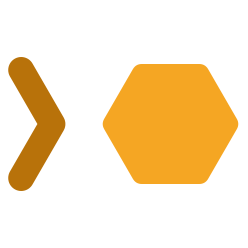
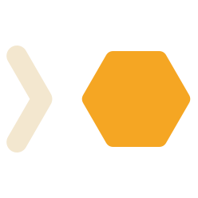
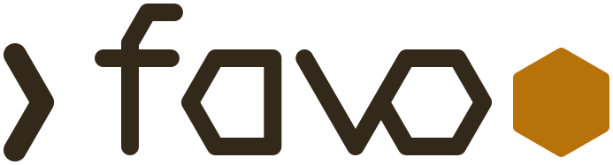
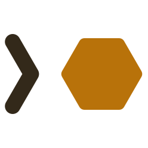

# favo brand assets

Two shapes, each in three colorways. The **logo** is the prompt chevron, the word `fav`, and a honeycomb cell as the `o`. The **mark** is just the chevron and the cell, on a square canvas, for favicons, avatars and anywhere the word would be too small to read.

| File                               | Shape | Use it on                                  | Ink       | Cell      |
| ---------------------------------- | ----- | ------------------------------------------ | --------- | --------- |
| [`logo.svg`](logo.svg)             | logo  | any background, when you cannot know which | `#B8720A` | `#F5A623` |
| [`logo-dark.svg`](logo-dark.svg)   | logo  | dark backgrounds                           | `#F3E7CF` | `#F5A623` |
| [`logo-light.svg`](logo-light.svg) | logo  | light backgrounds                          | `#33291A` | `#B8720A` |
| [`mark.svg`](mark.svg)             | mark  | any background, when you cannot know which | `#B8720A` | `#F5A623` |
| [`mark-dark.svg`](mark-dark.svg)   | mark  | dark backgrounds                           | `#F3E7CF` | `#F5A623` |
| [`mark-light.svg`](mark-light.svg) | mark  | light backgrounds                          | `#33291A` | `#B8720A` |

The colors come from favo's two default themes. The dark variants use Honey's text and accent, the light variants use Wax's, and the any-background variants pair Wax's amber ink with Honey's amber cell, which stays readable on both but with less contrast than a themed pair.

## Previews

|                | Logo                                                                         | Mark                                                                        |
| -------------- | ---------------------------------------------------------------------------- | --------------------------------------------------------------------------- |
| Any background |                       |                       |
| Dark           |    |    |
| Light          |  |  |

Each themed variant is meant to disappear on the opposite background, so one row above always looks faint.

## Screenshots

`favo-honey.png` and `favo-wax.png` are the same view in the Honey and Wax themes. `favo-remote.png` and `favo-themes.png` are taken in Honey.

## Switching with the GitHub theme

The project README shows the dark or light variant by adding `#gh-dark-mode-only` or `#gh-light-mode-only` to the end of the image path:

```html


```

GitHub hides the image whose fragment does not match the color mode the reader picked on GitHub. Avoid `<picture>` with `prefers-color-scheme`: the browser answers that from the operating system, so a reader with a light system and a dark GitHub gets the light image on a dark page.

The fragment follows GitHub's color mode, not the theme. A reader who puts a dark theme in GitHub's day slot still gets the light variant. Outside GitHub the fragments do nothing and both images show, so use the any-background variant wherever you cannot hide one of them.

## Changing the shapes

All six files share one set of paths. The mark is the logo without `fav`, with the cell moved in beside the chevron and centered on a square canvas. Change the geometry in every file together, and keep the colors to the table above.
